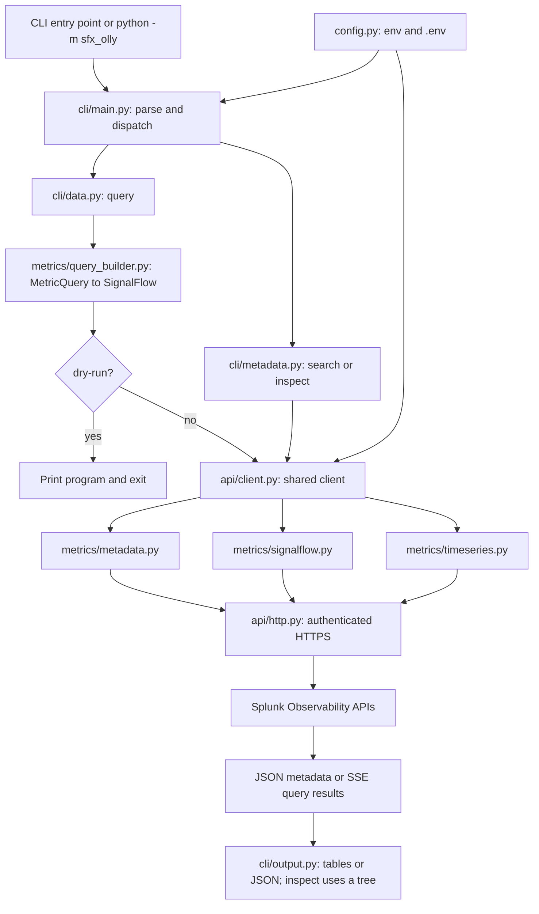
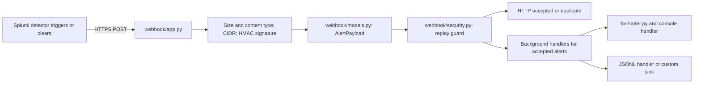

# Architecture

## Scope and boundaries

The package currently supports metric discovery/queries, detectors/incidents, and receiving
detector notifications. There is no watcher or metric-availability polling service.
Use a Splunk-managed detector with webhook delivery for known-stream availability alerts;
the receiver does not subscribe to a catalog of new metric names.

Metric-specific implementations live in `sfx_olly/metrics/`. Shared authentication,
HTTP pooling, retries, pagination, and errors stay separate so another signal can reuse
them without importing metric query builders. No empty traces/logs packages are scaffolded.

## Query flow



`metrics inspect` issues one bounded MTS search and groups dimension values locally.
`query` posts one program, consumes the finite historical SSE result, then exits.
Explicit pagination in library iterators retrieves additional pages, not repeated checks
waiting for new metrics. HTTP retries are bounded recovery from transient failures.

## Metric mental model

```text
metric: example.project.size
  series A
    dimensions: {environment: env-test, project.name: project-a, ...}
    datapoints: [(timestamp, value), ...]
  series B
    dimensions: {environment: env-prod, project.name: project-b, ...}
    datapoints: [(timestamp, value), ...]
```

A metric name is not a single number. Each distinct dimension set identifies a metric
time series (MTS). Dots in keys are literal: `host.name` is one flat key, not a nested object.
Dimension inspection groups values across series, not a Cartesian product of valid filters.
Use MTS search to examine combinations. Global dimension search can return keys/values
belonging to other metrics, so it is not a substitute for per-metric inspection.

Metadata indicates indexed objects, not that samples exist in a selected time range.
There is no exhaustive list of never-created metrics. Compare an explicit expected inventory
with observed metadata, then query values separately when checking recent activity.

## Webhook flow



This is an inbound notification path, independent of metric querying. HMAC uses
`WEBHOOK_SHARED_SECRET`; outbound Splunk API requests use `SFX_TOKEN`. The receiver's
background handlers and in-process replay guard are not a durable queue or global dedupe.

## Module Map

All paths below are relative to `sfx_olly/`.

| Module | Responsibility and main links |
| --- | --- |
| `__init__.py` | Package version and public `SplunkOllyClient` export. |
| `__main__.py` | Calls `cli.main.main` for `python -m sfx_olly`. |
| `config.py` | Validated API, logging, and webhook settings; secret discovery for redaction. |
| `exceptions.py` | Shared typed API/auth/rate-limit/SignalFlow failures caught by the CLI. |
| `logging_config.py` | Logging format and secret-redaction filter, installed by CLI startup. |
| `utils.py` | Duration parsing, epoch/UTC conversion, validation, and numeric display units. |
| `help.py` | Offline topic text rendered by `cli/help_cmd.py`. |
| `api/__init__.py` | Public API exports, including metric classes for existing callers. |
| `api/client.py` | Owns one transport and exposes metadata, timeseries, signalflow, alerts APIs. |
| `api/http.py` | Session pooling, token auth, TLS, timeouts, retries, request logging, HTTP errors. |
| `api/base.py` | Base API wiring, search syntax defaults, bounded search pagination. |
| `api/alerts.py` | REST calls for detector and incident metadata. |
| `metrics/__init__.py` | Public metric API classes, query specification, result/message types. |
| `metrics/metadata.py` | Metric/dimension/MTS search/get, pagination, and dimension inspection. |
| `metrics/query_builder.py` | Validates metric/filter/aggregation options and generates SignalFlow. |
| `metrics/signalflow.py` | POST execute, parse SSE, join metadata to samples, surface execution errors. |
| `metrics/timeseries.py` | Raw `/v1/timeserieswindow` queries without SignalFlow analytics. |
| `cli/__init__.py` | CLI package marker. |
| `cli/main.py` | Registers commands, configures logs, dispatches handlers, maps errors to exit codes. |
| `cli/metadata.py` | Metric/dimension/MTS commands and metric inspection tree/JSON. |
| `cli/data.py` | Query, raw timeseries, and custom SignalFlow commands; formats result series. |
| `cli/output.py` | Shared table/JSON rendering and stderr error output. |
| `cli/alerts.py` | Detector and incident list/get commands. |
| `cli/webhook.py` | Serve receiver, send signed test alerts, render saved alerts. |
| `cli/help_cmd.py` | Offline help command registration and dispatch. |
| `webhook/__init__.py` | Webhook package exports. |
| `webhook/app.py` | FastAPI factory, POST and health endpoints, validation/dispatch pipeline. |
| `webhook/models.py` | Payload validation/normalization and incident state properties. |
| `webhook/security.py` | HMAC signing/verification, IP checks, replay protection. |
| `webhook/formatter.py` | Terminal-safe alert text and Rich alert layout. |
| `webhook/handlers.py` | Handler protocol plus console and restrictive-permission JSONL sinks. |
| `webhook/server.py` | Uvicorn startup using webhook host/TLS/proxy settings. |
| `webhook/testing.py` | Sample payload and signed HTTP sender for local tests. |

`tests/test_metrics.py` contains offline metric/query/CLI regressions. `README.md` provides
the quick start; `docs/reference.md` contains full configuration, cURL examples for both
POST APIs, library usage, security, and troubleshooting.

## Adding Another Signal

1. Create a signal-specific package such as `sfx_olly/traces/` only when implementing it.
2. Check that signal's actual Splunk API, token permissions, query format, and retention.
   Do not reuse metric `data()` or `/v2/metric` for raw traces or logs.
3. Reuse `HttpTransport` and shared errors where compatible; add a specialized transport
   only if the signal's protocol requires one.
4. Attach its API object to `SplunkOllyClient` and register an independent CLI module.
5. Add focused mocked tests and document the new signal's own filters and result model.

The existing client attributes and `sfx_olly.api` exports remain supported. Direct imports
from the former metric-specific API submodules must use the new `sfx_olly.metrics` paths.
